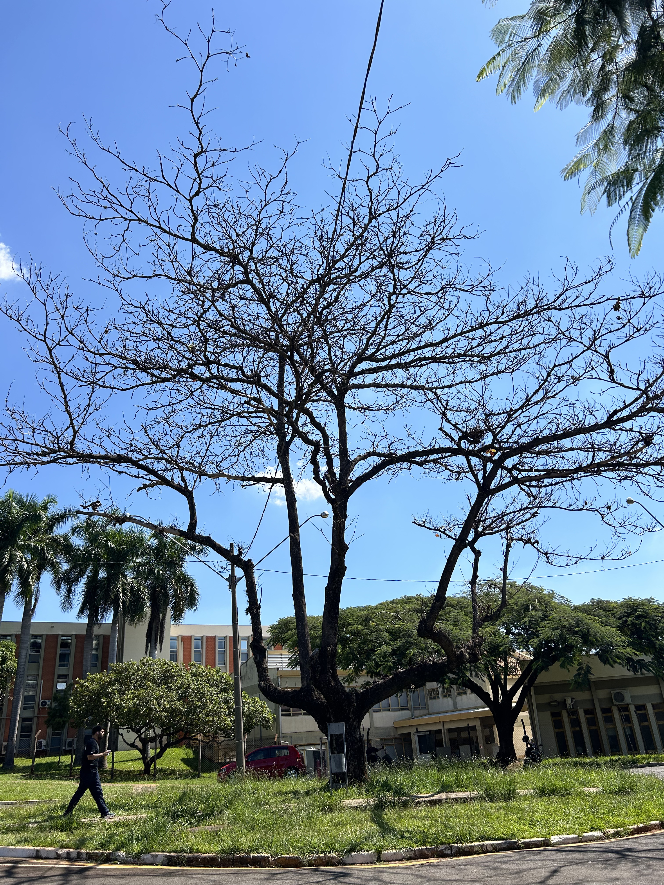
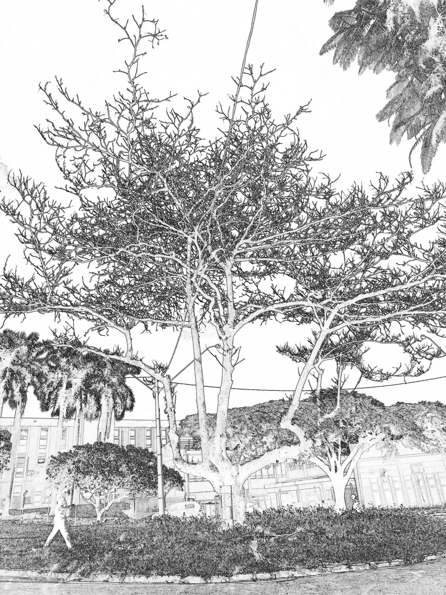
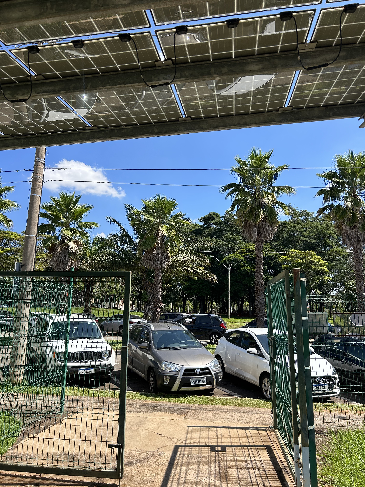
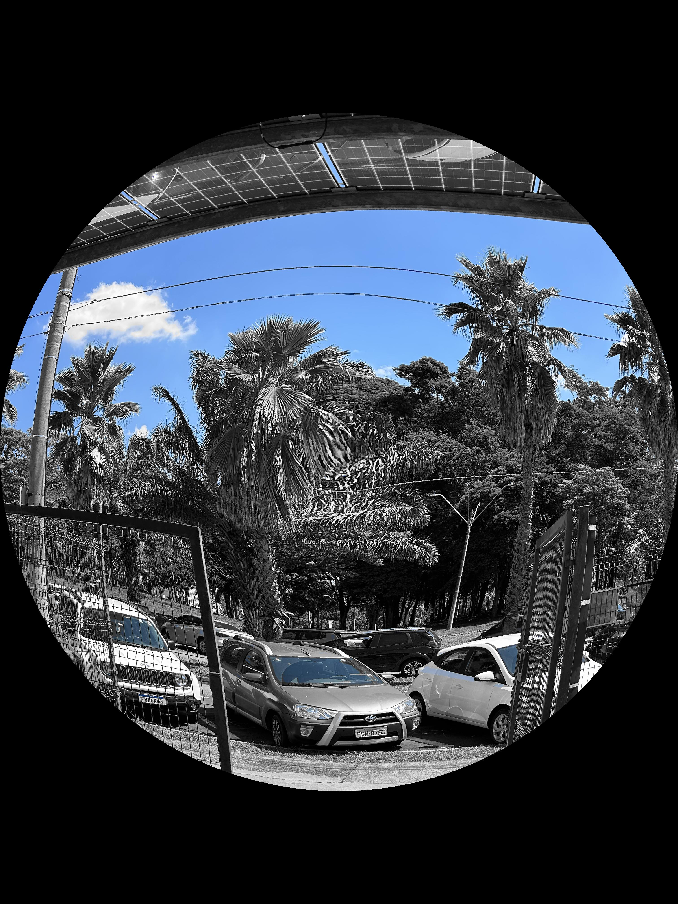
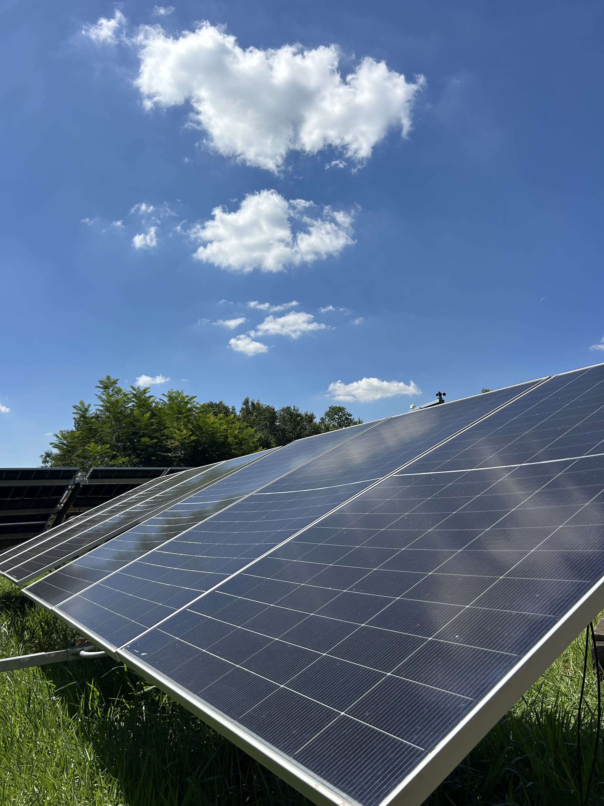
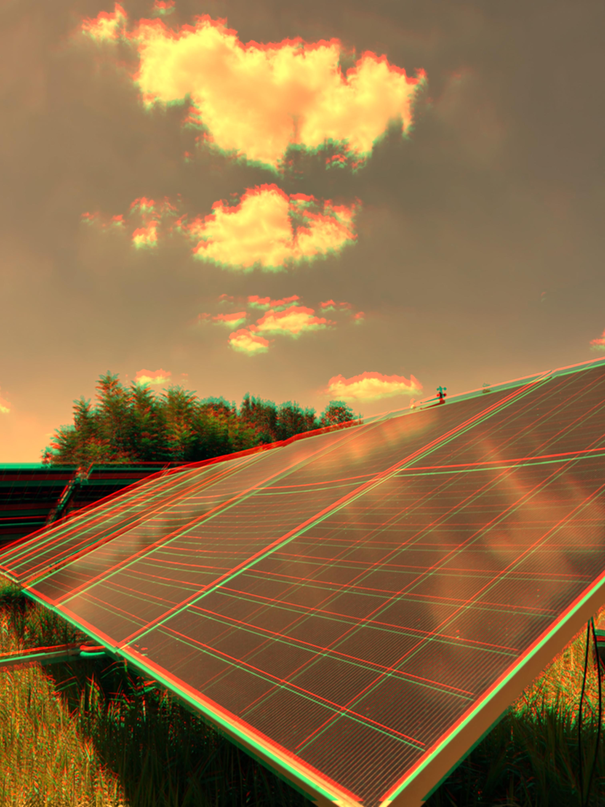

# 🎨 Image Processing · Visual Effects & Analysis

**Python · NumPy · Computer Vision · Machine Learning**  
Projects developed for **EA979 at UNICAMP** 🇧🇷.

### ✨ Before & after

Three examples from the original image collection and the corresponding processed outputs. The images below are real outputs saved during the project, not mockups.

| **Sample 02 · Original** | **Sample 02 · Processed** |
|:---:|:---:|
|  |  |

| **Sample 10 · Original** | **Sample 10 · Processed** |
|:---:|:---:|
|  |  |

| **Sample 11 · Original** | **Sample 11 · Processed** |
|:---:|:---:|
|  |  |

### 🧪 Custom effects

Implemented three image-processing transformations using NumPy:

- **Pencil sketch** — grayscale conversion, neighboring-pixel differences, edge enhancement and color inversion.
- **Heat wave** — RGB channel adjustments, vertical channel displacement (chromatic aberration) and a 7×7 mean filter.
- **Fisheye + selective color** — radial coordinate remapping with a blue-sky color mask and grayscale surroundings.

[Explore the Python implementations](./01-image-effects/src/unicamp_effects/effects/245609.py) · [Browse all original photos](./01-image-effects/photo/) · [Browse processed outputs](./01-image-effects/photo_result/)

### 🔬 Two-part project

| Part | Focus |
|---|---|
| [01 · Image Effects](./01-image-effects) | Custom NumPy-based image transformations and processed photography |
| [02 · Effects Analysis](./02-effects-analysis/Atividade.ipynb) | Exploratory analysis and machine-learning experiments on transformed images |

> **Academic project.** Starter materials, datasets and original repository links are documented in [SOURCES.md](./SOURCES.md). The comparison images are linked directly from the repository; no new image-processing output was generated for this README.
