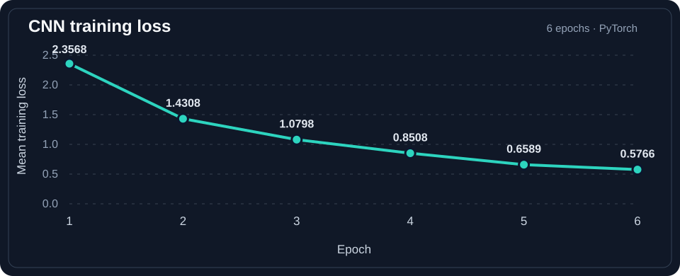
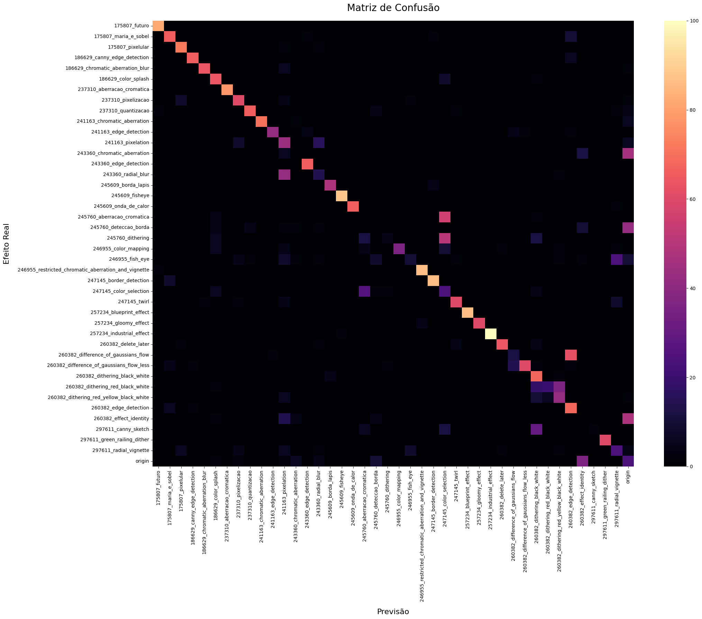
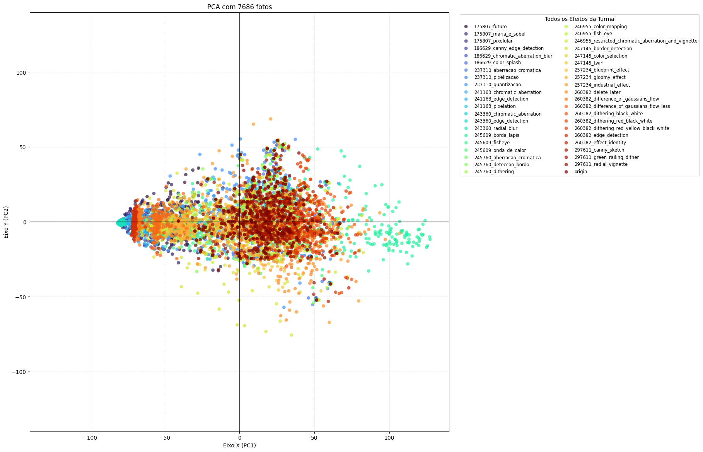

# Image Processing · Visual Effects and Analysis

**Python · NumPy · Computer Vision · Machine Learning**  
Projects developed for **EA979 at UNICAMP** 🇧🇷.

### Before and after

Three examples from the original image collection and the corresponding processed outputs. The images below are real outputs saved during the project, not mockups.

| **Sample 02 · Original** | **Sample 02 · Processed** |
|:---:|:---:|
|  |  |

| **Sample 10 · Original** | **Sample 10 · Processed** |
|:---:|:---:|
|  |  |

| **Sample 11 · Original** | **Sample 11 · Processed** |
|:---:|:---:|
|  |  |

### Custom effects

Implemented three image-processing transformations using NumPy:

- **Pencil sketch** — grayscale conversion, neighboring-pixel differences, edge enhancement and color inversion.
- **Heat wave** — RGB channel adjustments, vertical channel displacement (chromatic aberration) and a 7×7 mean filter.
- **Fisheye + selective color** — radial coordinate remapping with a blue-sky color mask and grayscale surroundings.

[Explore the Python implementations](./01-image-effects/src/unicamp_effects/effects/245609.py) · [Browse all original photos](./01-image-effects/photo/) · [Browse processed outputs](./01-image-effects/photo_result/)

### Machine learning — recognizing image effects

The second stage explored whether machine learning could distinguish **42 image-effect classes** across **7,686 images** resized to 128 × 128 pixels.

**CNN (PyTorch)** — A custom classifier with two convolutional layers, max-pooling and fully connected layers, trained with cross-entropy loss and Adam for **6 epochs**. The dataset was randomly split into **6,148 training** and **1,538 test images**.

| Recorded evaluation | Result |
|---|---:|
| **Test-set accuracy** | **66.71%** |
| Correct predictions | **1,026 / 1,538** |
| Mean training loss, epoch 1 | 2.3568 |
| Mean training loss, epoch 6 | 0.5766 |
| Training device | Apple Metal (MPS) |

These are **results recorded in the original notebook**, not a newly trained model.

<strong>View the saved confusion-matrix visualization</strong>

*The notebook's confusion-matrix visualization code appends predictions to lists already populated by the preceding cell. The displayed matrix is included as an archived illustration, **not** as the basis for the accuracy calculation above. The reported 66.71% comes from the notebook's separate test-evaluation cell.*

**PCA (unsupervised analysis)** — The same **7,686 images** were projected from 49,152 pixel features into two principal components to investigate similarities among visual effects.

<strong>View the saved PCA projection</strong>

**Key insight:** Similar visual effects can be difficult to distinguish, including some pixelation and edge-detection variants. PCA provides a view of visual similarities, while the CNN attempts to predict specific effect labels.

[Explore the full original analysis notebook](./02-effects-analysis/Atividade.ipynb)

---

### Two-part project

| Part | Focus |
|---|---|
| [01 · Image Effects](./01-image-effects) | Custom NumPy-based image transformations and processed photography |
| [02 · Effects Analysis](./02-effects-analysis/Atividade.ipynb) | Exploratory analysis and machine-learning experiments on transformed images |

> **Academic project.** Starter materials, datasets and original repository links are documented in [SOURCES.md](./SOURCES.md). The comparison images are linked directly from the repository; no new image-processing output was generated for this README.
